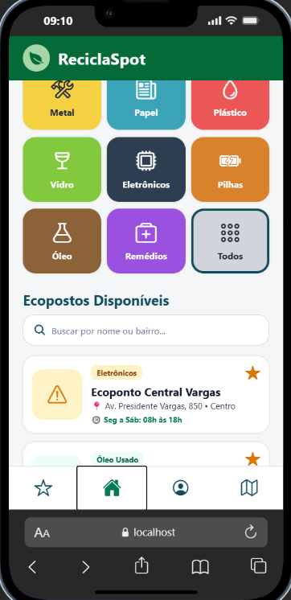
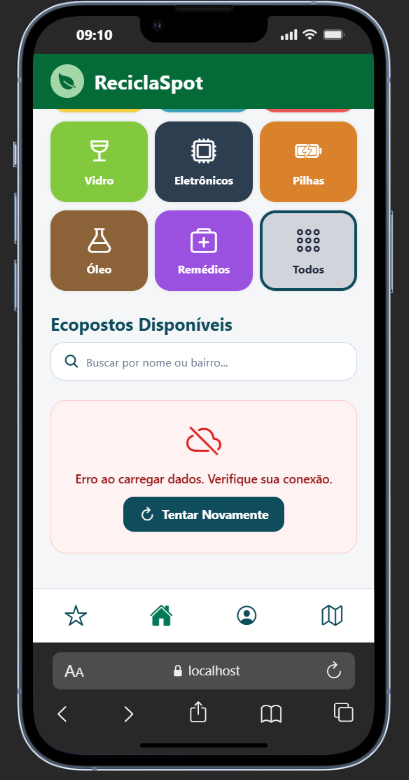

# ♻️ Reciclaspot

O **Reciclaspot** é um aplicativo móvel desenvolvido para conectar cidadãos de Osvaldo Cruz - SP a pontos de coleta seletiva e ecopontos, incentivando o descarte consciente e o acompanhamento de contribuições ambientais.

---

## 📱 Funcionalidades

- **Autenticação e Cadastro Real:** Fluxo inicial com *Splash*, *Login* e *Cadastro* integrado à API REST (`POST /usuarios`) com validação de formulários.
- **Exploração Dinâmica de Ecopontos:** Listagem em tempo real (`GET /ecopontos`) organizada por categorias (Eletrônicos, Óleo Usado, Pilhas/Baterias, Medicamentos) com busca por nome ou bairro.
- **Resiliência de Rede:** Atualização via *Pull-to-Refresh* (`RefreshControl`), limite de tempo (*timeout* de 8s) e tela de fallback com botão de nova tentativa.
- **Mapa Interativo & Detalhes:** Visualização de pontos de coleta, integração com mapas e dados detalhados (`GET /ecopontos/:id`) com endereços, horários e contatos.
- **Favoritos e Modo Offline:** Persistência local com `AsyncStorage` para salvar favoritos e histórico sem conexão.
- **Registro de Descartes e Perfil:** Sistema de pontuação, anexação de fotos e acompanhamento do impacto ambiental.

---

## 🛠️ Tecnologias Utilizadas

- **[React Native](https://reactnative.dev)** (v0.88) & **[Expo](https://expo.dev)** (SDK 58)
- **[TypeScript](https://www.typescriptlang.org)**
- **[Axios](https://axios-http.com)** & **JSON Server** (API RESTful)
- **[AsyncStorage](https://github.io)** (Persistência offline)
- **[React Navigation](https://reactnavigation.org)** (*Native Stack* e *Bottom Tabs*)
- **[Jest](https://jestjs.io)** & `jest-expo` (Testes unitários)
- **[EAS Build](https://expo.dev)** (Geração de APK Android)
- **[Expo Image Picker](https://expo.dev)** & **[Expo Vector Icons](https://expo.fyi)**

---

## 📂 Estrutura do Projeto

```text
Reciclaspot/
├── docs/               # Documentação e protótipo (Figma)
├── img/                # Imagens e capturas de tela
├── src/
│   ├── assets/         # Arquivos estáticos
│   ├── components/     # Componentes reutilizáveis
│   ├── hooks/          # Gerenciamento de estado global e API
│   ├── navigation/     # Configuração de rotas
│   ├── screens/        # Telas da aplicação (Home, Cadastro, Detalhes, Mapa, etc.)
│   ├── services/       # Cliente HTTP Axios e dados mockados
│   ├── types/          # Tipagens TypeScript
│   └── utils/          # Funções de validação e testes
├── db.json             # Banco de dados da API local
├── eas.json            # Configuração de build Android
├── jest.config.js      # Configuração de testes
├── App.tsx             # Componente principal
├── index.ts            # Registro do Expo
└── package.json        # Dependências e scripts
```

---

## 🚀 Como Executar o Projeto

### Pré-requisitos
- [Node.js](https://nodejs.org)
- [Git](https://git-scm.com)
- Aplicativo **Expo Go** (SDK 58) no smartphone ou navegador web.

### Passo a passo

1. **Clone o repositório:**
   ```bash
   git clone https://github.com/Raissa-Fernandes17/Reciclaspot.git
   ```
2. **Acesse a pasta:**
   ```bash
   cd Reciclaspot
   ```
3. **Instale as dependências:**
   ```bash
   npm install
   ```
4. **Inicie a API REST (JSON Server):**
   ```bash
   npx json-server --watch db.json --host 0.0.0.0 --port 3000
   ```
5. **Execute os testes unitários:**
   ```bash
   npx jest
   ```
6. **Inicie o servidor Expo:**
   ```bash
   npx expo start
   ```

---

## 📲 Download do APK (Android)

- **Download Direto:** [Baixar ReciclaSpot (.apk)](https://expo.dev/artifacts/eas/W1srxIL_2pbdFN4f-XgGm9Bf8u_uKGNZEipXD7s5-hQ.apk)

---

## 📸 Capturas de Tela & Testes

| Tela Inicial (API Conectada) | Tratamento de Falha de Rede | Testes Unitários (Jest) |
| :---: | :---: | :---: |
|  |  |  |

---

## 🎨 Protótipo & Evolução

- **Protótipo:** Planejado no Figma (consulte a pasta `docs/`).
- **Sprint 1 & 2:** Prototipação, navegação, acessibilidade WCAG e `AsyncStorage`.
- **Sprint 3:** Integração com Axios, resiliência de rede, Clean Code, Jest e EAS Build.

---

## 👩‍💻 Autoria

Desenvolvido por **Raissa Fernandes** e equipe.  
🔗 [GitHub](https://github.com/Raissa-Fernandes17/Reciclaspot.git)
